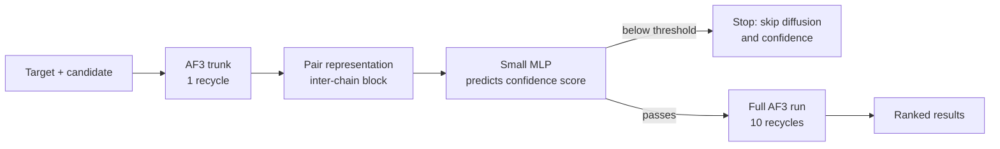

<p align="center">
  <picture>
    <source media="(prefers-color-scheme: dark)" srcset="docs/assets/logo.png">
    
  </picture>
</p>


# 🧬 latentPPI: efficient whole-proteome screening

Screen a **target protein** against a proteome using full AF3 or latentPPI-gated inference. One YAML config handles input preparation, Slurm submission, resume, and ranking. Here, *target* means the query protein; *candidates* are the proteins screened against it.

> **Early release:** latentPPI is under active development. Features, configuration options, and documentation may change. AF3 image download and build-repository links are **coming soon**.

[First screen](examples/toy_screen/WALKTHROUGH.md) · [Configuration reference](CONFIG.md) · [Metrics reference](METRICS.md)

## 🔬 How it works

Running full AlphaFold 3 on every target–candidate pair in a proteome is
expensive, and most pairs turn out not to interact. latentPPI cuts that cost
by deciding early which pairs are worth a full prediction.



1. **First pass.** Each pair runs through AlphaFold 3's trunk (the Pairformer)
   for a single recycle. This is the part of AF3 that builds its internal
   picture of how the two chains relate.
2. **Read the internal representation.** latentPPI takes AF3's pair
   representation, the matrix AF3 uses to encode relationships between
   residues, and keeps only the block between the two chains. It summarizes
   that block into a fixed-size feature vector.
3. **Predict, then gate.** A small neural network (MLP), trained on AF3 runs of
   known interacting and non-interacting human protein pairs, predicts a
   confidence score (for example ipSAE) from that vector. Pairs scoring below
   your threshold stop here and skip AF3's structure-generation (diffusion)
   and confidence steps.
4. **Advance the survivors.** Pairs that pass get a fresh, full 10-recycle AF3
   run with structure scoring. Final results are ranked by these full-run
   scores.

**Why this works.** In our benchmarks, the *ranking* of pairs is largely set
after the first recycle, even though the score values themselves keep shifting
with more recycles. So the gate is best used to rank and shortlist, not as an
exact predictor of the final score.

**What it can miss.** Some pairs only reach a high score after several
recycles ("late bloomers") and look unpromising at recycle 1. The gate will
filter some of these out. You trade some recall for compute; choosing a
lower threshold keeps more pairs and loses fewer.

**What the scores mean.** latentPPI predicts AlphaFold 3's own confidence
metrics. It does not predict biological interaction directly. AF3 confidence
favors stable, structured interfaces, so transient or disordered interactions
may score low regardless.

**Current scope.** The bundled checkpoints were trained on human
heterodimers up to 2,000 combined residues. Homodimers and larger complexes
are outside the training range.

## 🧰 Install
```bash
git clone https://github.com/fareedaabu/latentPPI.git
cd latentPPI

conda env create -f environment.yml
conda activate latentppi
```

You need Python 3.10+ with PyYAML, pandas, and NumPy; Slurm, Bash, flock, and Singularity; and the patched AF3 image, weights, and databases. AF3 image links are **coming soon**; see the AF3 SIF image section below. Obtain weights through the [AlphaFold3 repository](https://github.com/google-deepmind/alphafold3), following its terms of use. The `ipsae.py` script is included; see its [repository](https://github.com/DunbrackLab/IPSAE) for more details.

### 📦 AF3 SIF image

latentPPI works through a patched AlphaFold3 image that allows pair representation extraction and the gating required to score a complex before a full inference pass.

- Prebuilt AF3 SIF image download: **coming soon**.
- `af3-latentppi` build repository: **coming soon**. Building the image requires `Docker`, followed by conversion to a `.sif` with `Singularity`.

Set `AF3_IMAGE` to the resulting SIF path when running the screen. 

## 👶🏻👩🏽‍💻 Run A Toy Screen

The [toy example](examples/toy_screen/WALKTHROUGH.md) pairs one synthetic target with 50 candidates. Its supplied MSA avoids an MSA search; its full-run config disables scoring, pooling, and compression.

**First edit [full.yaml](examples/toy_screen/full.yaml)** with your AF3 paths, conda environment, CPU/GPU partitions, and GPU request. Then run from the repository root:

```bash
conda activate latentppi

mkdir -p examples/toy_screen/run
cp examples/toy_screen/query_msa/target_small.a3m examples/toy_screen/run/target_small.a3m

python latentppi.py validate examples/toy_screen/full.yaml
python latentppi.py run examples/toy_screen/full.yaml --no-submit
python latentppi.py run examples/toy_screen/full.yaml

# Once input preparation finishes:
python latentppi.py status examples/toy_screen/full.yaml
python latentppi.py status examples/toy_screen/full.yaml --heavy
```

`run` prepares inputs, submits GPU tasks after preparation succeeds, and collects metrics after the tasks finish—even if some fail. Re-run the same command after jobs terminate to submit only unfinished pairs.

The toy sequences and alignments test the workflow, not biological interactions. For preparation without Slurm or AF3, follow the [local check](examples/toy_screen/WALKTHROUGH.md#local-check-without-a-cluster).

**To try a gated screen**, edit the [latent toy config](examples/toy_screen/config.yaml) with your AF3 paths and Slurm settings. It uses the bundled ipSAE_d0dom scorer and writes to `./run_latent`.

```bash
mkdir -p examples/toy_screen/run_latent
cp examples/toy_screen/query_msa/target_small.a3m examples/toy_screen/run_latent/
python latentppi.py validate examples/toy_screen/config.yaml

python latentppi.py run examples/toy_screen/config.yaml
python latentppi.py advance examples/toy_screen/config.yaml --watch
```

> **Prerelease:** Automatic advancement inside the AF3 image is planned. For
> now, after submitting the screen, start `advance --watch` and leave it
> running. It submits passing pairs for a fresh, ungated 10-recycle run.


## 🫵 Use your own target


### 📋 What you need for a screen

Before running your own screen, gather:

| What | Where it goes in the config | Notes |
| --- | --- | --- |
| Target sequence | `inputs.fasta_file` | One sequence in a FASTA file. |
| Candidate MSAs | `inputs.proteome_msa_dir` | One `.a3m` per candidate protein, in one shared folder.|
| Patched AF3 image | `af3.image`  | The `.sif` file. |
| AF3 model parameters | `af3.model_parameters_dir`| Your own copy from Google DeepMind. |
| AF3 databases | `af3.databases_dir`  |  |
| Scorer checkpoint (gated screens) | `scorer.models` | Bundled in `models/checkpoint/`. |
| Cluster settings | `cluster.*` | Your CPU and GPU partition names and GPU request. |

A typical layout:

```
my_screen/
├── config.yaml            # copied from examples/toy_screen/config.yaml
├── target.fasta           # your target sequence
└── run/                   # inputs.output_base: created and filled by latentPPI
    └── target.a3m         # optional: a supplied target MSA (name must match the FASTA)

/shared/proteome_msas/     # inputs.proteome_msa_dir
├── P12345.a3m
├── Q67890.a3m
└── ...
```

If you don’t supply target.a3m, latentPPI generates the target MSA with ColabFold. Supplying your own target MSA is optional.

Start from [full.yaml](examples/toy_screen/full.yaml) or the [latent config](examples/toy_screen/config.yaml). Set:

- `inputs.fasta_file`: one target sequence.
- `inputs.proteome_msa_dir`: candidate `.a3m` files in a shared directory.
- `inputs.output_base`: the screen's output directory.
- `paths.script_dir`, `af3.*`, and `cluster.*`: your checkout, resources, and scheduler settings.

Input/resource paths resolve relative to the YAML; output paths resolve relative to `output_base`. Checkpoint paths resolve relative to `script_dir`. Update relative paths if you move the YAML.

A supplied target MSA must be the only root-level `.a3m` in the output directory. Its filename must match the FASTA stem (`target.fasta` → `target.a3m`), and its first sequence must match the target. Candidate MSAs stay in their shared directory; keep them readable on compute nodes.

Make sure to run `validate` on your final yaml to ensure that latentPPI accepts it. 

### 🎯 Enable latent scoring

Candidates can be scored by five metrics we have trained on: ipTM, ipSAE (and derivatives), LIS, pDockQ and pDockQ2. We recommend predicting ipTM_af and ranking by ipSAE_d0dom. 

```yaml
runner: latent
scorer:
  rank_by: ipSAE_d0dom
  threshold: 0.5
  models:
    ipTM_af: {path: models/checkpoint/latentppi_max_ipTM_af__emb-r1_score-r1_model.pt} #listing both models predicts both metrics
    ipSAE_d0dom: {path: models/checkpoint/latentppi_max_ipSAE_d0dom__emb-r1_score-r1_model.pt}
```

A higher threshold keeps fewer pairs, saving compute but missing more true hits. Start with the example value, check what fraction of pairs pass, and adjust.

`rank_by` selects the predicted gate metric. Completed pairs rank by measured ipTM within pLDDT groups (above 70 first, then 70 or below, then missing scores). Gate predictions have a separate `gate_rank`. Add models to predict more metrics; all configured models are used unless `predict_metrics` selects a subset. Pairs gated below the threshold skip diffusion and have no structure-derived ipSAE. See [CONFIG.md](CONFIG.md) for manifests and optional stages.

## 💾 Create your Own 'Proteome'
The project proteome download is **coming soon**. To screen your own proteome, generate an MSA for each candidate sequence. See the [ColabFold setup guide](https://colabfold.mmseqs.com/) for local search requirements.


## 📌 Everyday commands

Replace `config.yaml` with your config path.

| Command | Action |
| --- | --- |
| `python latentppi.py validate config.yaml` | Check settings and resources |
| `python latentppi.py clean config.yaml --dry-run` | Preview removal of generated results |
| `python latentppi.py clean config.yaml` | Remove only results and keep prepared inputs and the query FASTA |
| `python latentppi.py clean config.yaml --all` | Remove results and prepared inputs after confirmation; keep the query MSA |
| `python latentppi.py run config.yaml --no-submit` | Preview submissions without submitting |
| `python latentppi.py run config.yaml` | Start or resume the first-pass screen |
| `python latentppi.py advance config.yaml --watch` | During a latent screen, automatically submit passing pairs for a full 10-recycle run as they become available |
| `python latentppi.py advance config.yaml` | After a latent screen finishes, submit all newly eligible pairs in one batch |
| `python latentppi.py advance config.yaml --no-submit` | Refresh the candidate CSV and list newly eligible pairs without submitting jobs |
| `python latentppi.py status config.yaml` | Light status (default): skip metrics recomputation; show completion counts and recorded Slurm jobs |
| `python latentppi.py status config.yaml --heavy` | Heavy status: recompute metrics files, then show completion counts and recorded Slurm jobs |
| `python latentppi.py inputs config.yaml` | Prepare or update inputs only |
| `python latentppi.py render config.yaml` | Write environment/config artifacts only |

### Advance passing pairs to 10 recycles

> **Prerelease:** Automatic advancement inside the AF3 image is planned. For
> now, after submitting the screen, start `advance --watch` and leave it
> running. It submits passing pairs for a fresh, ungated 10-recycle run.

**Advancement starts when you run `advance`.** For a latent screen, submit the first pass and then start the watcher with the same config on a host that can submit Slurm jobs.

```bash
python latentppi.py run config.yaml
python latentppi.py advance config.yaml --watch
```

Leave the watcher running. It checks for completed pairs with at least one passing seed and submits one advance batch at a time. Each pair gets a fresh, ungated AF3 run with its original input and seeds, **10 recycles by default**, and structure scoring. The default polling interval is 300 seconds. Restarting the watcher picks up new passes and skips pairs already assigned to a batch.

**If the first pass has already finished**, run `python latentppi.py advance config.yaml` once. To preview the selection first, add `--no-submit`. To request a different recycle count, use `--recycles N`.

Read `metrics/advanced_candidates.csv` for first-pass scores and the latest published advance status. The `advance_` score columns and `advance_rank` use the second run. Refresh the source CSV on demand with `status config.yaml --heavy`. Each batch has its own config, manifests, predictions and logs under `advance/batch-*/`. If a batch fails, inspect its Slurm jobs and resume it with `python latentppi.py run <batch>/advance.yaml`. A reserved batch with an unconfirmed submission is shown as `prepared`. Check the queue before resubmitting it.

### Resume or change a screen

Use `run --force` to repeat completed predictions. Use `run --force-inputs` to regenerate preparation **including the target MSA**, which requires ColabFold. Combine both to regenerate everything.

For new candidates, run `inputs`, wait for it to finish, then run `run`. Wait for existing first-pass jobs to finish before resubmitting `run`. When changing models or scientific settings, use a new output directory. The saved screen identity rejects incompatible reuse; `--force` repeats work with compatible settings.

`run` defaults to **chained dispatch**: a one-CPU dispatcher submits one GPU array
and a dependent continuation, then exits. Slurm keeps the continuation pending
until the batch and its submitting dispatcher finish. No dispatcher CPU remains
allocated while the GPU batch runs or waits in the queue. Each continuation
submits the next batch or eligible one-time retries; the final step schedules
collection. A continuation can add a short CPU-queue delay between batches.

Set `cluster.max_concurrent_tasks` for the screen-wide running-task limit and
`cluster.user_queue_budget` for your user submission budget (pending plus running
tasks, including other jobs). For a 50-job limit, use `user_queue_budget: 50`,
`reserved_queue_slots: 2`, and `max_concurrent_tasks: 4`. Chained mode additionally
reserves one submission slot for the continuation. Quota checks are disabled by
default (`user_queue_budget: null`); Slurm limits still apply.

`dispatcher_time_limit` now defaults to **one hour per invocation**, not the full
screen duration; increase it if collecting a very large screen needs longer. We recommend you set it to a high duration.
`dispatcher_cpus_per_task` defaults to one independently of GPU task CPU counts.
Use `dispatch_mode: persistent` for the old wait-loop behavior, including separate
CPU/GPU Slurm clusters. Old saved snapshots retain persistent behavior and their
original resource settings, so already-submitted screens are not migrated.
If a handoff fails, accepted jobs continue; inspect `status` and resume with `run`
after recorded jobs finish. See [cluster settings](CONFIG.md#cluster-resources-and-arrays).

For readable queue labels, set `cluster.job_name: cool-protein`; jobs will appear as
`cool-protein-array`, `cool-protein-dispatch`, etc.

Gated pairs count as completed. While jobs are active, unfinished attempts can appear as failed/incomplete; check their queue state too. Use `run --no-submit` to preview scheduler submissions.

## 📊 Find your results

Default paths under `inputs.output_base`:

| Path | Contents |
| --- | --- |
| `metrics/advanced_candidates.csv` | Confirmed gate passes with first-pass metrics, advance status, and available full-run scores |
| `metrics/ranked_survivors.tsv` | Completed pairs ranked by confidence group and measured ipTM |
| `metrics/all_results.tsv` | Every pair, its outcome, gate prediction and final scores |
| `metrics/known_interactors.tsv` | Every supplied known-interactor entry, including missing or killed pairs |
| `metrics/summary.txt` | Settings, score definitions and outcome counts |
| `metrics/screen_status.json` | Counts and outstanding indices |
| `af3_predictions/` | Predictions, timing records, and `run_env.json` GPU/job metadata |
| `ipsae_summary_af3.csv` | Retained internal source of structure scores |
| `slurm_logs/` | Job logs |
| `latentppi_runs/` | Submission IDs and config/environment snapshots |

Full runs rank completed pairs by measured scores. With the default ranking, pairs missing scores share the last rank group. Observed ipSAE uses the highest `ipSAE` among `Type=max` rows per system and seed. For custom collection:

```bash
python collect_metrics.py --root /path/to/screen \
  --out-dir /path/to/screen/metrics --rank-by ipSAE_d0dom --agg mean
```

Results refresh at batch boundaries by default. In persistent mode, `output.refresh_seconds` controls the periodic interval. Use `output.known_interactors` to supply one proteome target ID per line. Use the target MSA filename without `.a3m`. [Known-interactor matching rules](METRICS.md#known-interactors)

See [METRICS.md](METRICS.md) for output columns and aggregation, and [CONFIG.md](CONFIG.md) for prepared input files, array limits, and runner settings.

## Complex size cutoff (optional)

To skip folding complexes above a chosen combined length, add this to your config:

```yaml
cluster:
  max_total_residues: 3000
```

This allows up to **3,000 total residues across both chains** and excludes larger
complexes from submission. Omit the option or set it to `null` to disable it.
The limit applies to both runners and dispatch modes, including retries and
`--force`, before any GPU tier routing.

Large complexes remain in generated inputs and command files, preserving task
indices. Status and results label unfinished excluded pairs `skipped_length`;
completed results are retained. Raise the limit and rerun to include previously
excluded pairs without rebuilding inputs. Existing submitted jobs keep their
saved settings. See the [cutoff reference](CONFIG.md#complex-size-cutoff) for
details, including preview behavior and manually submitted runners.

## Size-based GPU routing (optional)

New screens can route complexes by **total residues across both chains**. Our
recommended two-tier example keeps **up to and including 3,000 residues** on the
regular GPU and sends larger complexes directly to the large GPU:

```yaml
cluster:
  gpu_tiers:
    - name: regular
      max_total_residues: 3000
      partition: your_regular_gpu_partition
      gres: gpu:your_regular_gpu_type:1
    - name: large
      partition: your_large_gpu_partition
      gres: gpu:your_large_gpu_type:1
  retry_failed_once: true
```

**We chose 3,000 conservatively based on our L40 screening runs**, with additional
A100 40GB OOM evidence. It is a routing heuristic, not a guaranteed memory limit.
Users with smaller GPUs should lower the cutoff or add a smaller tier; GPU memory,
AF3 padding and inference settings affect capacity. The GPU investigation report is coming soon.

Replace the example resources with your cluster's actual partition/GRES names.
Tiers are ordered by increasing size, with an unbounded final tier. Any failed
pair gets at most one retry on the final tier, including pairs initially routed
there. Gate-rejected pairs are not failures. The retry budget persists on resume.

Omitting `gpu_tiers` (or using `[]`) preserves the existing single-resource behavior;
this feature does not change existing screen configs or queued jobs. With tiers,
omit `retry_partition`/`retry_gres`: the final tier provides the retry resources.
See [configuration details](CONFIG.md#size-based-gpu-tiers).


## Tests

```bash
python -m unittest discover -s tests -v
```

Tests mock Slurm and inference. Postprocessing checks also need `h5py` and `zstd`; the optional shard-merger check is skipped when that helper is absent.

## License

- **Code:** Apache License 2.0. See [LICENSE](LICENSE).
- **ipSAE:** `ipsae.py` is from [DunbrackLab/IPSAE](https://github.com/DunbrackLab/IPSAE), used under the MIT License. See [THIRD_PARTY_NOTICES.md](THIRD_PARTY_NOTICES.md).
- **Model checkpoints:** the files in `models/checkpoint/` are **not** covered by the Apache license. They were trained on AlphaFold 3 outputs and are distributed under the AlphaFold 3 Output Terms of Use, for non-commercial use only. See the terms files in [models/checkpoint/](models/checkpoint/).
- **AlphaFold 3:** this repository does not include AlphaFold 3 source code or model parameters. To run the pipeline, obtain AlphaFold 3 model parameters directly from Google DeepMind under their terms.

latentPPI is not affiliated with or endorsed by Google DeepMind.